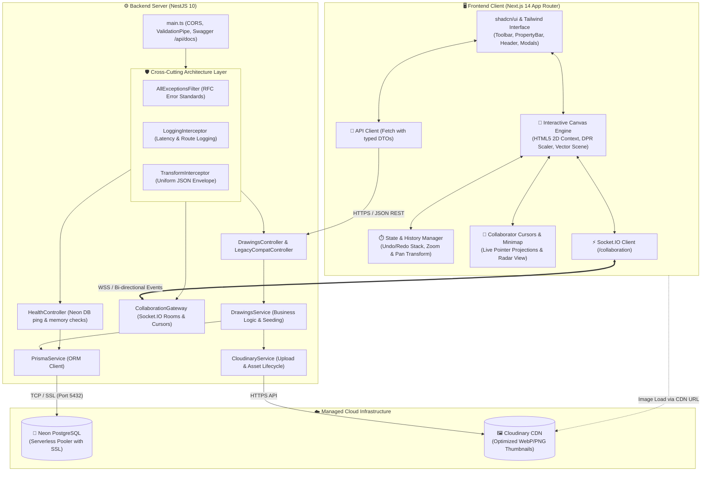

# 🎨 Whiteboard Studio — Enterprise Real-Time Collaborative Canvas

<div align="center">


**A production-grade, full-stack collaborative digital whiteboard engineered with Next.js 14, TypeScript, NestJS, Neon Serverless PostgreSQL, Prisma ORM, Cloudinary, and Socket.IO.**

[Features](#-key-features) • [Architecture](#-system-architecture) • [Tech Stack](#-technology-stack) • [Database Schema](#-database-architecture) • [API Contracts](#-api-specification) • [Local Setup](#-getting-started) • [Shortcuts](#-keyboard-shortcuts)

</div>

---

## 📌 Executive Summary

**Whiteboard Studio** is an enterprise-grade digital whiteboard built to deliver high-performance visual brainstorming, diagramming, and multi-user collaboration. 

Designed following **Clean Architecture** principles:
* **Frontend**: Next.js 14 App Router, TypeScript, and a custom HTML5 2D Vector Canvas rendering pipeline that supports infinite zoom/pan, high-DPI scaling, 11 interactive tools, an undo/redo state engine, and real-time remote cursor projection.
* **Backend**: NestJS 10 modular micro-architecture with auto-generated Swagger OpenAPI docs, Prisma ORM connected to Neon Serverless PostgreSQL with SSL connection pooling, Cloudinary CDN asset pipelines, and a bi-directional WebSocket gateway for multi-user collaboration.

---

## 🌟 Key Features

### 🖌️ 1. High-Performance Graphics & Canvas Engine
* **11 Interactive Tools**: Freehand Pencil, Rectangle, Circle / Ellipse, Diamond, Arrow, Line, Text Annotation, Sticky Notes, Eraser, Selection / Move, and Hand (Pan).
* **Infinite Canvas & Transformations**: High-precision coordinate space projection converting viewport pixels to canvas world coordinates across infinite zoom ($0.2\times$ to $3.0\times$) and panning planes.
* **Retina High-DPI Scaling**: Pixel-perfect rendering matching `window.devicePixelRatio` with zero blurriness or distortion.
* **Interactive Element Manipulation**: Select, drag to reposition, duplicate (`Clone`), and delete any element directly on the canvas.
* **Undo / Redo History Stack**: Non-destructive Memento pattern state management with keyboard shortcuts (`Ctrl+Z`, `Ctrl+Y`).
* **Live Radar Minimap**: Real-time floating minimap in the corner displaying the entire scene overview and current viewport bounding box.

### 👥 2. Real-Time Collaboration (WebSockets / Socket.IO)
* **Live Cursor Streaming**: Throttled 40Hz bi-directional broadcast of collaborator cursor coordinates with distinct user avatar colors and name tags.
* **Real-Time Element Synchronization**: Instant broadcast of newly created, modified, or deleted shapes to all room participants.
* **Live Presence Indicators**: Header status badge displaying active collaborators connected in real time.

### ☁️ 3. Cloud Persistence & Cloudinary CDN Integration
* **Dual Persistence Pipeline**:
  1. **Visual Snapshot**: Offscreen rasterization uploaded to **Cloudinary CDN** with automatic WebP/PNG optimization.
  2. **Vector Scene Storage**: Full JSON vector element tree saved to **Neon PostgreSQL** via **Prisma ORM**, allowing any board to be reloaded and edited anytime.
* **Cloud Gallery & Search**: Search drawings by title or numeric ID (e.g. `#1`, `#2`), filter by category pills (*Shapes, Annotations, Diagrams, Wireframes*), and load boards with 1 click.
* **Self-Healing Schema**: Automated `ensureTablesExist()` initialization in the NestJS backend to automatically create tables and indexes on first startup.

### 📦 4. Multi-Format Export Engine
* **Export as PNG**: High-resolution image export with custom background rendering.
* **Export as Vector SVG**: Mathematical vector serialization into clean XML `<svg>` markup.
* **Project JSON Interchange**: Export and import complete `.whiteboard.json` files for offline backups and cross-session editing.

### 🛡️ 5. Enterprise Observability & Resilience
* **System & DB Health Endpoint**: `/api/health` monitoring Neon PostgreSQL round-trip latency (ms), uptime, and memory consumption (`rss`, `heapUsed`).
* **Unified API Envelope**: Interceptors standardizing all HTTP responses into `{ success, statusCode, data, timestamp }`.
* **Centralized Exception Filter**: Global error filter returning clean RFC-compliant error payloads with server-side stack trace logging.
* **Interactive Swagger UI**: Interactive API testing dashboard at `/api/docs`.

---

## 📐 System Architecture



---

## 🛠️ Technology Stack

| Domain | Technology | Version | Purpose |
| :--- | :--- | :--- | :--- |
| **Frontend Framework** | Next.js (App Router) | `14.2.x` | Server/Client components, SSR, and production bundling |
| **Language** | TypeScript | `5.6.x` | Strict type safety across client and server |
| **Styling & UI** | Tailwind CSS + shadcn/ui | `3.4.x` | Responsive design, dark/light themes, Radix primitives |
| **Icons & Notifications** | Lucide React + Sonner | `0.441.x` | Iconography and toast feedback system |
| **Backend Framework** | NestJS | `10.4.x` | Modular architecture, dependency injection, controllers |
| **Database ORM** | Prisma | `5.19.x` | Type-safe queries, migrations, and relationship handling |
| **Database Engine** | PostgreSQL (Neon DB) | Serverless | Cloud-native pooled PostgreSQL with SSL encryption |
| **Real-Time Gateway** | Socket.IO | `4.7.x` | Low-latency WebSockets for multi-user collaboration |
| **Cloud Media Storage** | Cloudinary SDK | `2.5.x` | Image transformation, optimization, and CDN delivery |
| **API Documentation** | Swagger / OpenAPI | `7.4.x` | Interactive API documentation at `/api/docs` |
| **Validation** | class-validator / transformer | `0.14.x` | DTO validation and input sanitization |

---

## 🗄️ Database Architecture

The application persists drawings into **Neon PostgreSQL** via Prisma using the following schema:

```prisma
model Drawing {
  id                 String   @id @default(uuid())
  shortId            Int      @unique @default(autoincrement())
  title              String   @default("Untitled Board")
  description        String?
  category           String   @default("shape")
  imageUrl           String   @db.Text
  thumbnailUrl       String?  @db.Text
  cloudinaryPublicId String?
  elements           Json     @default("[]")
  appState           Json?
  isSample           Boolean  @default(false)
  createdAt          DateTime @default(now())
  updatedAt          DateTime @updatedAt

  @@index([category])
  @@index([isSample])
  @@index([createdAt])
}
```

### ⚡ Optimization Strategy
* **`shortId` Unique Index**: Enables human-readable numeric lookup (e.g. search by `#1` or `#12`).
* **`category` & `isSample` Indexes**: Zero-latency filtering for gallery tabs and sample template loading.
* **`createdAt` Index**: Fast descending pagination for the "Latest Drawings" feed.
* **`pgbouncer` Connection Pooling**: Built-in support for Neon's connection pooler to prevent connection spikes under high traffic.

---

## 📡 API Specification

### REST Endpoints (`/api`)

| Method | Endpoint | Request Body | Description |
| :--- | :--- | :--- | :--- |
| `POST` | `/api/drawings` | `CreateDrawingDto` | Uploads snapshot to Cloudinary and saves vector elements to Neon DB |
| `GET` | `/api/drawings` | Query (`category`, `search`, `page`, `limit`) | Paginated list of drawings with filtering and sorting |
| `GET` | `/api/drawings/:id` | — | Retrieves single drawing by UUID or numeric `shortId` |
| `PATCH` | `/api/drawings/:id` | `UpdateDrawingDto` | Updates drawing title, elements, or snapshot |
| `DELETE` | `/api/drawings/:id` | — | Deletes drawing and cleans up Cloudinary CDN asset |
| `GET` | `/api/drawings/latest` | — | Quick feed of the 12 most recent drawings |
| `GET` | `/api/drawings/sample` | — | Retrieves built-in template drawings |
| `POST` | `/api/drawings/seed-samples`| — | Seeds default architectural diagrams and sticky notes |
| `GET` | `/api/health` | — | System health check (PostgreSQL ping latency, memory) |
| `GET` | `/api/docs` | — | Interactive Swagger / OpenAPI documentation |

### WebSockets Events (`/collaboration`)

| Event Name | Direction | Payload | Description |
| :--- | :--- | :--- | :--- |
| `join-room` | Client ➔ Server | `{ roomId, userName, userColor }` | Joins a collaborative drawing session |
| `room-users` | Server ➔ Client | `Array<UserPresence>` | Returns list of all active users in the room |
| `user-joined` | Server ➔ Client | `UserPresence` | Notifies room members of a new collaborator |
| `user-left` | Server ➔ Client | `{ socketId }` | Notifies room members when a user disconnects |
| `cursor-move` | Client ➔ Server | `{ roomId, x, y }` | Broadcasts user's live cursor position |
| `cursor-moved` | Server ➔ Client | `{ socketId, x, y, userName, userColor }` | Renders remote collaborator cursor on canvas |
| `element-update` | Client ➔ Server | `{ roomId, element, action }` | Broadcasts element creation, modification, or deletion |
| `element-updated`| Server ➔ Client | `{ element, action, fromSocketId }` | Live updates canvas elements for all peers |
| `canvas-clear` | Client ➔ Server | `{ roomId }` | Broadcasts canvas wipe to all room members |

---

## 📁 Project Directory Structure

```text
Whiteboard-App/
├── backend/
│   ├── prisma/
│   │   ├── schema.prisma       # PostgreSQL schema & connection configuration
│   │   └── seed.ts             # Sample drawings seeder
│   ├── src/
│   │   ├── collaboration/      # Socket.IO Real-Time WebSockets Gateway
│   │   │   ├── collaboration.gateway.ts
│   │   │   └── collaboration.module.ts
│   │   ├── common/             # Enterprise Interceptors & Filters
│   │   │   ├── filters/http-exception.filter.ts
│   │   │   ├── interceptors/logging.interceptor.ts
│   │   │   └── interceptors/transform.interceptor.ts
│   │   ├── health/             # System Health & DB Ping Endpoint
│   │   │   ├── health.controller.ts
│   │   │   └── health.module.ts
│   │   ├── cloudinary/         # Cloudinary CDN SDK Wrapper
│   │   │   ├── cloudinary.service.ts
│   │   │   └── cloudinary.module.ts
│   │   ├── drawings/           # Drawings CRUD Feature Module
│   │   │   ├── dto/            # Class-validator DTOs (create, update, query)
│   │   │   ├── drawings.controller.ts
│   │   │   ├── drawings.service.ts
│   │   │   └── drawings.module.ts
│   │   ├── prisma/             # Global Prisma Client Provider
│   │   ├── app.module.ts       # Root NestJS Module
│   │   └── main.ts             # App Bootstrap (Swagger, CORS, Pipes)
│   ├── .env.example            # Backend environment template
│   ├── package.json
│   └── tsconfig.json
│
├── frontend/
│   ├── public/                 # Static assets, SVG branding
│   ├── src/
│   │   ├── app/
│   │   │   ├── globals.css     # CSS variables, grid lines & dot patterns
│   │   │   ├── layout.tsx      # Root layout, Inter font & Toaster
│   │   │   └── page.tsx        # Main Whiteboard application workspace
│   │   ├── components/
│   │   │   ├── ui/             # shadcn/ui components (Button, Dialog, Tabs, Dropdown...)
│   │   │   └── whiteboard/     # Whiteboard Canvas, Toolbar, PropertyBar, Header,
│   │   │                       # Minimap, CollaboratorCursors, ShortcutsModal, Gallery
│   │   ├── hooks/
│   │   │   └── useCollaboration.ts # WebSockets client hook
│   │   ├── services/api.ts     # Typed REST API Client
│   │   └── types/              # Universal TypeScript data interfaces
│   ├── .env.example            # Frontend environment template
│   ├── tailwind.config.ts
│   ├── next.config.mjs
│   └── package.json
│
└── README.md                   # Complete Project Documentation
```

---

## 🚀 Getting Started

### Prerequisites
* **Node.js**: v18.0.0 or higher
* **npm**: v9.0.0 or higher
* Free accounts on **Neon PostgreSQL** and **Cloudinary**

---

### Step 1: Clone the Repository
```bash
git clone https://github.com/Ramjanict/Whiteboard-App.git
cd Whiteboard-App
```

---

### Step 2: Backend Setup (NestJS + Prisma + PostgreSQL)

1. Navigate to `backend`:
   ```bash
   cd backend
   npm install
   ```

2. Configure environment variables in `backend/.env`:
   ```env
   PORT=8080
   DATABASE_URL="postgresql://<user>:<password>@<host>/<database>?sslmode=require"
   CLOUDINARY_CLOUD_NAME="your_cloud_name"
   CLOUDINARY_API_KEY="your_api_key"
   CLOUDINARY_API_SECRET="your_api_secret"
   CLOUDINARY_URL="cloudinary://<key>:<secret>@<cloud_name>"
   FRONTEND_URL="http://localhost:3000"
   ```

3. Push database schema to Neon:
   ```bash
   npx prisma db push
   npx prisma generate
   ```

4. Start the NestJS backend:
   ```bash
   npm run start:dev
   ```
   * **API Base URL**: `http://localhost:8080/api`
   * **Swagger API Documentation**: `http://localhost:8080/api/docs`
   * **Health Check**: `http://localhost:8080/api/health`

---

### Step 3: Frontend Setup (Next.js + TypeScript + Tailwind)

1. Open a new terminal and navigate to `frontend`:
   ```bash
   cd frontend
   npm install
   ```

2. Configure environment variables in `frontend/.env`:
   ```env
   NEXT_PUBLIC_API_URL=http://localhost:8080/api
   NEXT_PUBLIC_WS_URL=http://localhost:8080/collaboration
   ```

3. Start the Next.js dev server:
   ```bash
   npm run dev
   ```
   * **Frontend Web Application**: `http://localhost:3000`

---

## ⌨️ Keyboard Shortcuts

| Shortcut | Category | Action |
| :---: | :--- | :--- |
| `H` | Tools | **Hand tool** (Pan canvas) |
| `V` | Tools | **Selection tool** (Select, move, clone elements) |
| `P` | Tools | **Freehand Pencil** |
| `R` | Tools | **Rectangle tool** |
| `C` | Tools | **Circle / Ellipse tool** |
| `D` | Tools | **Diamond tool** |
| `A` | Tools | **Arrow tool** |
| `L` | Tools | **Straight Line tool** |
| `T` | Tools | **Text Annotation tool** |
| `S` | Tools | **Sticky Note tool** |
| `E` | Tools | **Eraser tool** |
| `Ctrl + Z` | History | **Undo** last action |
| `Ctrl + Y` | History | **Redo** action |
| `Ctrl + S` | Cloud | **Save to Cloud** (Neon DB + Cloudinary) |
| `Delete` / `Backspace` | Actions | **Delete** selected element |
| `Ctrl + Mouse Wheel` | Viewport | **Zoom in / out** centered on cursor |
| `Space + Drag` | Navigation | **Quick pan** across canvas |
| `?` | Help | Open **Shortcuts Reference Dialog** |

---

## 👨‍💻 Engineering Profile & Contact

**Md Ramjan Ali**  
*Full-Stack Software Engineer*  

* **GitHub**: [@Ramjanict](https://github.com/Ramjanict)  
* **Email**: [mdramjan.ict@gmail.com](mailto:mdramjan.ict@gmail.com)  
* **Project Repository**: [https://github.com/Ramjanict/Whiteboard-App](https://github.com/Ramjanict/Whiteboard-App)  

---

<div align="center">
  <sub>Engineered with precision for modern engineering teams. If you find this project valuable, please star ⭐ the repository!</sub>
</div>
